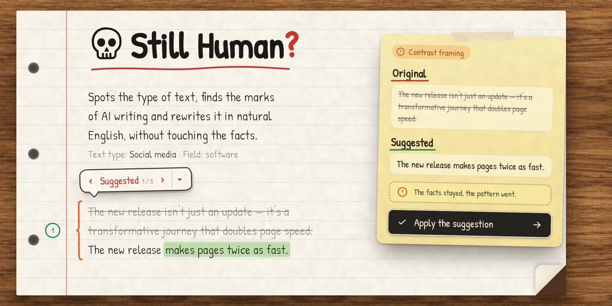
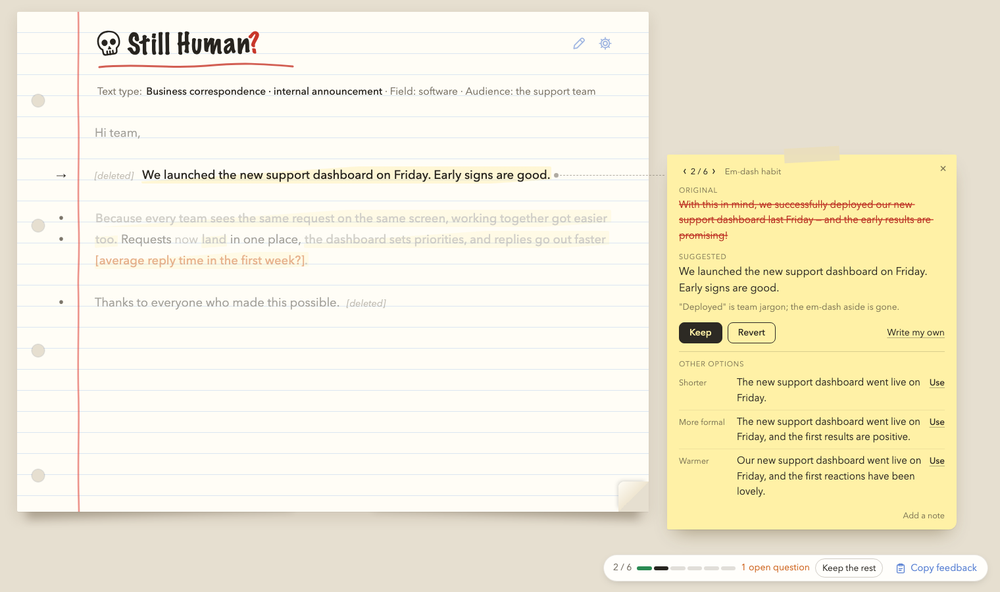
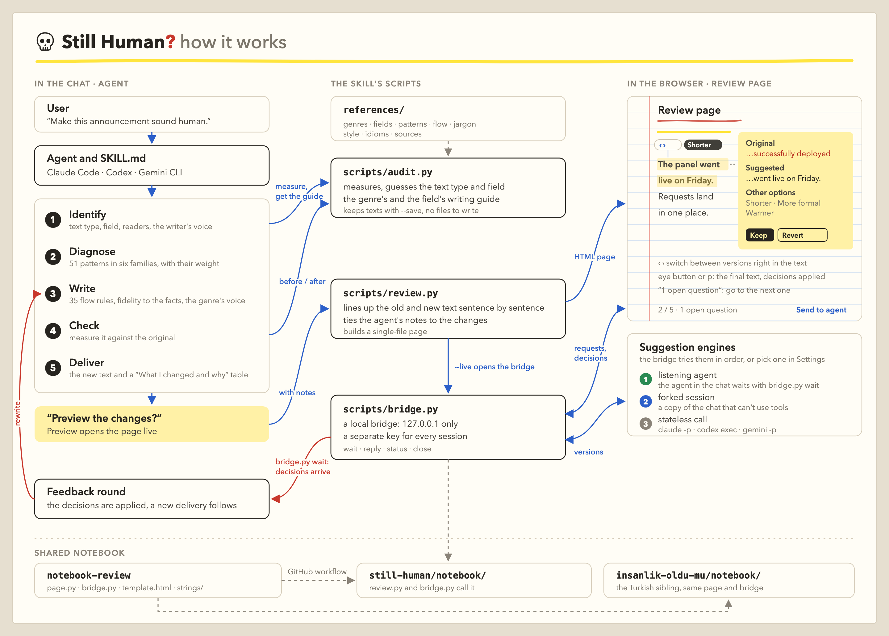

# Still Human?



You can often tell from the first line that an announcement, a post or an e-mail came out of a machine:
- It opens with "In today's fast-paced world".
- Something "isn't just a tool, it's a game-changer".
- There's an em dash in every paragraph, and a "delve", a "pivotal" and a "seamless" somewhere.
- It ends on "The future is bright" or "What do you think? Let me know in the comments!"

**Still Human?** is an agent skill that finds these marks and rewrites the text the way a person would write it, without touching its facts. It works in Claude Code, Codex and Gemini CLI, and any agent that can read files can use its instructions (`SKILL.md`).

Writing in Turkish? The sibling skill is [İnsanlık öldü mü?](https://github.com/MesutARIDORU/insanlik-oldu-mu).

## Quick start

**1. Install.** Paste this into a terminal:

```bash
npx skills add MesutARIDORU/still-human -g -y -a claude-code codex gemini-cli
```

It installs the skill into Claude Code, Codex and Gemini CLI without asking any questions. You need Node.js and Python 3. To install into other agents, or to pick from a list, see [Installation](#installation).

**2. Use it.** Give your agent the text and say what you want:

```
Humanize this e-mail:
[text]
```

"Humanize", "make it sound less like ChatGPT", "it sounds robotic", "was this written by AI?" all work. You can also call the skill by name:

| Tool | Command |
|---|---|
| Claude Code | `/still-human [text]` |
| Codex | `$still-human [text]` |
| Gemini CLI | `/still-human [text]` (added by the optional setup script) |

**3. Get the result.** When the skill starts, this line appears in the chat first:

> 💀 **Still Human❓** · Text type: business correspondence (e-mail) · Field: finance · Approach: …

Then come the rewritten text and a "What I changed and why" table. At the end the skill asks whether you want to see the changes on the review page. To open the page later, just type "preview".

## What it does differently

**It knows what kind of text it's reading.** In a poem the line break is the poet's decision. In a specification "shall" states an obligation, and the "Kind regards" at the end of a business e-mail is there out of courtesy. Mistake those for AI tells and you damage the text. The skill first recognises the type and the field, then works in that type's language:
- poetry and literary narrative,
- essay and personal writing,
- business correspondence,
- technical specification and technical documentation,
- academic, legal and news writing,
- marketing copy and social media.

It leaves poems alone by default and only shows the tells. In a specification it removes untestable adjectives and doesn't touch the modal verbs. In an e-mail the greeting stays and the throat-clearing goes.

Each field has its own guide too: software, finance, health, education, law, public sector, e-commerce, HR and marketing. The guides say who reads the text, which terms stay, how models leave their mark in that field, and which facts would do harm if they changed. The rate and the date in a bank's e-mail, the dose and timing in a patient leaflet and the clause number in a contract stay exactly as written.

As it starts, the skill says in one line what it's dealing with:

> 💀 **Still Human❓** · Text type: business correspondence (e-mail) · Field: finance · Approach: full rewrite, greeting and sign-off kept

The skull and the red question mark are the logo: that's how you know the skill is at work. The same profile appears under the title on the review page.

**It doesn't invent facts.** Most tools that "humanize" AI text make it concrete by inventing figures, company names or anecdotes. The reader publishes it, and the invention goes out into the world. This skill adds nothing that isn't in the source. Where the text needs to be concrete, it brings forward a fact that's already there, leaves a placeholder in square brackets, or asks you.

**It looks at the skeleton first.** Which words "sound like AI" changes with every new model. The structural marks stay:
- sentences of the same length,
- the "it's not X, it's Y" frame,
- everything in threes,
- a participle tail on every other sentence (", highlighting the importance of…").

The skill changes the skeleton first, then fills the gap with English's own tools:
- the news first,
- a named actor instead of an agentless passive,
- a short sentence next to a long one,
- plain verbs, phrasal verbs and contractions where the register allows them.

**Every change has a reason.** Each delivery comes with a change table: before, after, why. The reasons come from a coded pattern catalog, so they stay consistent.

**You have the last word.** The text and the change table arrive straight away. Then the skill asks in the chat: "Do you want to see the changes on the review page?" The options are "Preview" and "No thanks". Claude Code shows them as clickable options; in Codex and Gemini CLI you just type the answer.

If you choose to preview, the changes open on a page that looks like a notebook:
- Only the changed words are marked: medium weight, with a very faint yellow highlighter behind them. Where something was deleted, a small "[deleted]" note sits.
- Click a sentence and a note card opens. It has three parts:
  - **Original:** the old sentence, with the removed words struck through.
  - **Suggested:** the new one, with the added words in bold.
  - **Other options:** the same sentence shorter, more formal and warmer.

  You decide with "Keep", "Revert", "Use" next to the option you like, or "Write my own". The arrows at the top of the card move between changes.
- On a wide screen the card opens beside the page at the top and stays there while the page scrolls. A thin dashed line joins it to the sentence. In a narrow window, such as the browser inside your agent, it opens under the sentence. On a phone it rises from the bottom of the screen.
- Marks in the margin and the last line of the page show which changes you've looked at and which you've reverted. Information asked for in square brackets is orange and counted. Click "1 open question" to jump to the next one.
- Hover over a change and small arrows appear at its start. They step through the suggestion, the shorter, more formal and warmer versions and the original, right in the text. The version's name shows beside them for a moment.
- The eye button next to the title, or the `p` key, shows the final text with your decisions applied and nothing else. The same arrows appear there when you hover over a changed part.



**The page talks to the agent.** When it's opened live:
- In the box at the bottom of the card you can ask for "more casual" or "with an idiom", and the agent sends two or three more options.
- "Send to agent" sends your decisions to the chat, no copy and paste needed.

Suggestions come from one of three places, which you choose in the page's settings:
- the agent in your chat,
- a copy of the chat that knows its context,
- a quick call without context.

The page and the bridge are shared with the Turkish skill İnsanlık öldü mü?. Both come from the [notebook-review](https://github.com/MesutARIDORU/notebook-review) repository and are copied into the skill's `notebook/` folder, so a fix to the page reaches both skills. The page's English lives in `notebook/strings/en.json`.

**It measures, too.** `scripts/audit.py` counts the things detectors and editors notice:
- sentence length variety and runs of same-length sentences,
- repeated openers and connectives (Additionally, Moreover…),
- participle tails and opening -ing phrases,
- em-dash density,
- contrast framing, announced reveals and triads,
- AI vocabulary, buzzwords, inflated wording, hidden verbs and hedge stacks,
- e-mail formulas, stock openings and closings,
- US/UK spelling mixes and heading case,
- Flesch reading ease and grade level.

The delivery shows the before and after values side by side.

## How it works

`SKILL.md` is the skill's brain. The agent works through the text in five steps: it identifies the text, diagnoses it, writes, checks and delivers. `scripts/audit.py` measures the text and prints the genre and field guides, which come from the `references/` folder. If you want a preview, `scripts/review.py` builds the review page and `scripts/bridge.py` opens a bridge between the page and the agent that runs on your computer only. Requests for other versions and your decisions travel over that bridge, and the decisions come back to the text in a feedback round.



## Installation

Still Human? works with Claude Code, Codex and Gemini CLI. You need Node.js (for `npx`) and Python 3.8 or newer. The scripts use only Python's standard library; nothing else gets installed.

`npx skills` does the installing. It puts a single copy of the skill into the shared `~/.agents/skills` folder and records it in the lock file (`~/.agents/.skill-lock.json`). Codex and Gemini CLI read the skill from that folder, and Claude Code gets a link to it. If your other skills were installed the same way, they all live in one place.

### One command

```bash
npx skills add MesutARIDORU/still-human -g -y -a claude-code codex gemini-cli
```

It asks no questions. At the end you see a summary like this:

```
◇  Installed 1 skill
│  ✓ ~/.agents/skills/still-human
│    universal: Codex, Gemini CLI
│    symlinked: Claude Code
```

### Picking from the list

```bash
npx skills add MesutARIDORU/still-human -g
```

The command asks, in this order:

1. **Which agents do you want to install to?** The "Universal" section at the top lists Codex, Gemini CLI and the other agents that read the shared folder. They're always included; you don't need to select them. **Claude Code isn't in that section and isn't ticked.** Type `claude` in the Search field below, tick Claude Code with the space bar, then press Enter. If you skip this, the skill isn't installed into Claude Code.
2. **Installation method:** asked only if you selected an extra agent. "Symlink (Recommended)" is preselected; press Enter.
3. **Proceed with installation?** It first shows a summary and the skill's security scan. "Yes" is preselected; press Enter.

### Optional settings

That's the installation done; the skill is ready to use. If you want any of these three things, the setup script in the installed copy does them:
- **Claude Code:** adds permissions so the skill and its scripts run without asking each time. It backs up your settings file first.
- **Codex:** if you have many skills installed, Codex may not pick this one by itself. The script adds a three-line routing note to Codex's global instructions.
- **Gemini CLI:** adds the `/still-human` command.

```bash
python3 ~/.agents/skills/still-human/scripts/install.py
```

The script doesn't install the skill again. It asks before each setting and touches no file you haven't agreed to. Its options, and installing without Node.js, are in [INSTALL.md](INSTALL.md).

### How do I know it's installed?

Give your agent an English text and say "humanize this". If the skill is at work, this line appears in the chat first:

> 💀 **Still Human❓** · Text type: business correspondence (e-mail) · Field: finance · Approach: …

| Tool | Picks the skill by itself | To call it by name |
|---|---|---|
| Claude Code | Yes | `/still-human` |
| Codex | With the routing note from the setup script, yes. Without it, and with many skills installed, it may not | `$still-human` |
| Gemini CLI | Reads the skill from the shared folder; picking it by itself hasn't been tested | `/still-human` (added by the setup script) |

### Updating and removing

To update:

```bash
npx skills update still-human
```

To remove:

```bash
npx skills remove still-human -g
```

How to remove the permissions and the note the setup script added, and manual installation for other tools that read AGENTS.md, are in [INSTALL.md](INSTALL.md).

## Usage

Give your agent the text and say what you want:

```
Humanize this LinkedIn post; the readers are a general audience:
[text]
```

| What you want | Say |
|---|---|
| Full rewrite | "humanize", "make it sound natural", "rewrite it so it flows" |
| Light touch | "don't change too much, just fix it" |
| Diagnose | "was this written by AI?", "score it but don't change it" |
| Write from scratch | "write this announcement in natural English" |
| In your own voice | Add two or three paragraphs of your own writing. The skill takes sentence length, register, how you address the reader and your word choices from them, and carries none of their facts into the text |

You can also call the skill by name: `/still-human` in Claude Code and Gemini CLI, `$still-human` in Codex.

## An example

**Before** (internal announcement):

> In today's fast-paced business environment, efficiency is more important than ever. With that in mind, I'm thrilled to announce that we've officially rolled out our new expense platform — a game-changer for how we manage spending!
>
> This isn't just a new tool; it's a fundamental shift in how we work. Receipts can now be uploaded from your phone, approvals are routed automatically, and reimbursements are processed significantly faster.

**After:**

> Our new expense platform is live.
>
> You can upload receipts from your phone, the platform routes approvals for you, and reimbursements are faster [by how much?].

What changed:
- The stock opening and the significance inflation went.
- The news came first, and the dash aside and "game-changer" went with the old opening.
- "This isn't just a new tool; it's a…" went: the contrast frame had no fact behind it.
- The agentless passives got a named actor.
- "Significantly faster" had no figure behind it. None was invented; the skill asks for it in square brackets.

## Tech and business jargon

The yardstick for word choice is the language the reader actually uses. The decision depends on the audience:
- **Text for a developer team:** "deploy", "PR", "CI" stay as they are. Spelling them out ("Pull Request (PR)") for engineers is a tell.
- **Text for general readers:** "goes live" and "update" rather than the team's "shipped to prod".
- **Any text:** words that make a text sound technical or strategic without saying what anything does are a tell: seamless, robust, end-to-end, leverage, empower, synergy.

## What it leaves alone

- **Sound writing:** passive voice in a methods section is the right register there. A clean text that went through an editor isn't AI-written. The skill looks for clusters, not single words.
- **Things it never changes:** quotations, proper names, code, product names, interface labels, figures, doses, dates and legal wording.
- **Dialogue:** a dash that breaks off speech in a story stays.
- **Human marks:** when the skill sees odd but specific details, mixed feelings, a regional idiom or a writer interrupting themselves, it touches the text less.

## Where the rules come from

- **Public style guides:** the GOV.UK A to Z style guide and its plain-language guidance, the Google developer documentation style guide and the US digital.gov plain-language guides were read for the style rules: numbers, dates, dashes, contractions, capitals and words to avoid. The skill cites them by name where it follows them.
- **Readability:** the Flesch reading ease and Flesch–Kincaid grade formulas in `audit.py`.
- **Usage:** in word choice, the yardstick is what the audience actually says: "deploy" for engineers, "goes live" for customers.
- **Field notes:** the readers, terms and sensitive facts of nine fields are in `references/sectors.md` and `references/jargon.md`.
- **Our own test set:** eight sample texts in `evals/` with the behaviour expected for each.

The full list is in [references/sources.md](references/sources.md).

## License

MIT. Copyright © 2026 MesutARIDORU. See [LICENSE](LICENSE).
